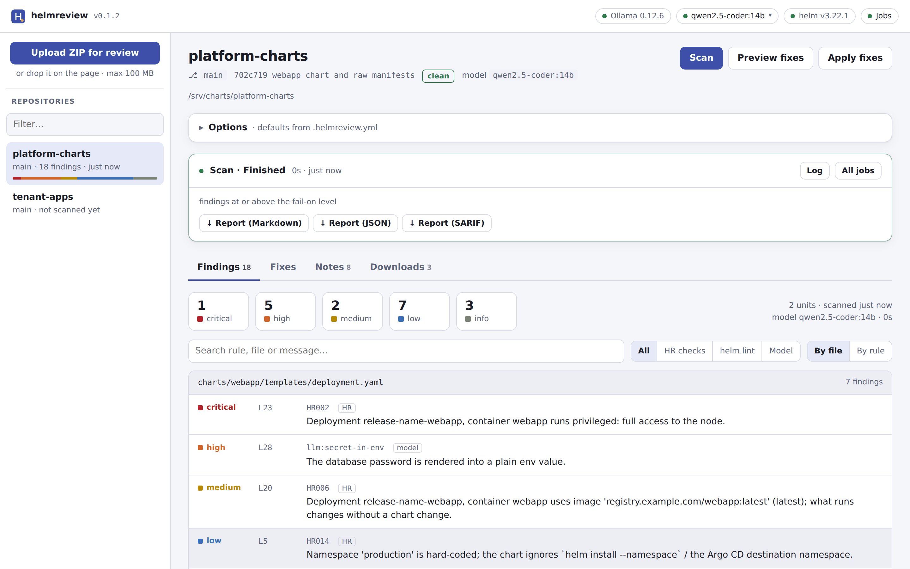
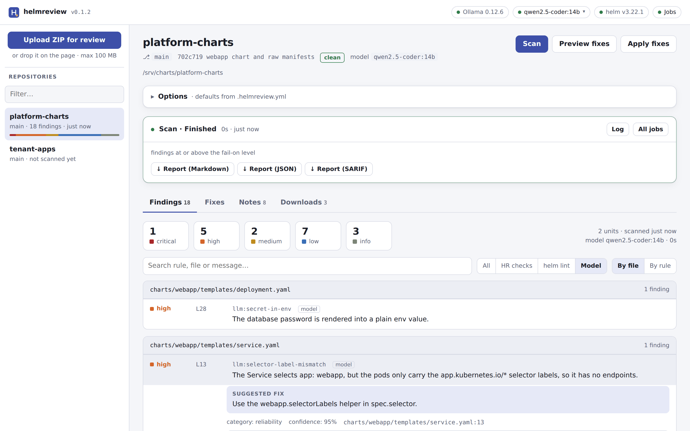
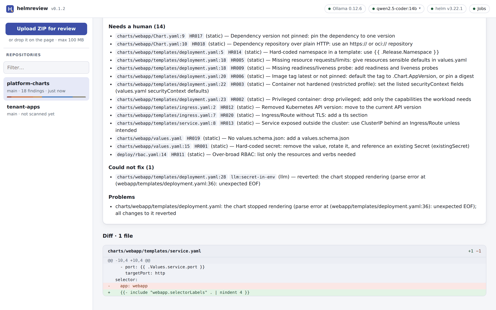
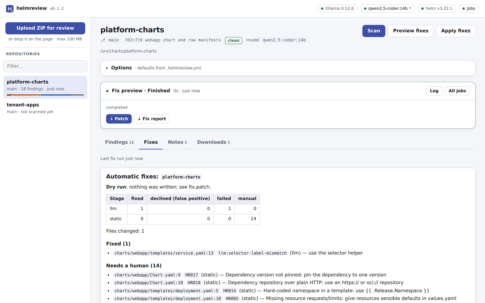
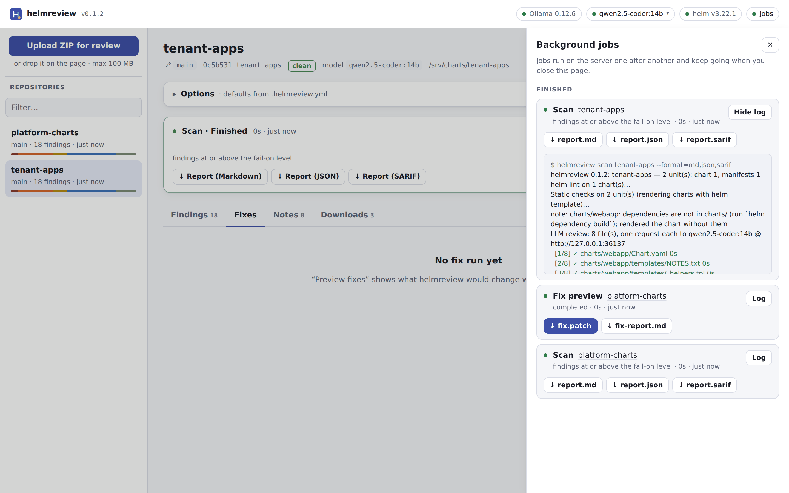

# helmreview

[](https://github.com/jwklijnsma/helmreview/actions/workflows/docker.yml)
[](https://jwklijnsma.github.io/helmreview/)

Review Helm charts and Kubernetes manifests with three layers, all running on your own hardware:

1. **`helm lint`** for chart structure, template errors and deprecated APIs.
2. **Built-in static checks (HR0xx) on what the chart actually produces.** Every chart is
   rendered with `helm template` and its default values, and each object is checked and
   mapped back to the template it came from: privileged or root containers, missing
   securityContext hardening (the *restricted* Pod Security Standard / OpenShift
   `restricted-v2`), host namespaces and hostPath, `latest` image tags, missing resources and
   probes, cluster-admin and wildcard RBAC, removed API versions, Ingress/Route without TLS,
   hard-coded namespaces, hard-coded secrets in `values.yaml`, unpinned dependencies. Plain
   manifests (Kustomize bases, Argo CD apps, raw YAML) get the same object checks.
3. **A local Ollama model** that reviews each template with the chart's `values.yaml` next to
   it: wrong scope (`.` vs `$`), values that don't exist, selectors that don't match the pods,
   names that can exceed 63 characters, missing checksum annotations, upgrade traps. It is told
   what the first two layers found, so it looks for new problems.

No code leaves your network, and `helm` never talks to a cluster. Reports come out as
Markdown, JSON, SARIF and GitLab Code Quality.

📖 **Documentation: <https://jwklijnsma.github.io/helmreview/>**



## Features

- **Scan** a repo, or only what a branch changed (`--diff origin/main`).
- **Fix** model findings: edits are verified first, and only kept when the chart still
  renders with `helm template`. Nothing is ever committed.
- **Web UI** (`helmreview serve`): scan, browse findings, preview and apply fixes, upload a
  ZIP, with a job queue on the server. Works air-gapped.
- **GitLab merge requests** (`helmreview watch-mrs`): polls GitLab and keeps one comment per
  merge request up to date. No CI change in your repos.
- **Container and service**: `ghcr.io/jwklijnsma/helmreview` with helm built in, installed as
  a Podman Quadlet service with one command (`deploy/systemd/install.sh`).

<details>
<summary>More screenshots</summary>

| | |
|---|---|
|  |  |
| A model finding with its suggested fix and the code around it | The diff of a fix preview; nothing is committed |
|  |  |
| The fix report: fixed, declined, needs a human | Background jobs with their downloads |

</details>

## Quick start

```bash
git clone https://github.com/jwklijnsma/helmreview.git && cd helmreview
pip install .                 # Python 3.10+, and helm 3 or 4 on the PATH
ollama pull qwen2.5-coder:14b # any coding model works; bigger is better if VRAM allows
helmreview doctor             # checks helm, Ollama and the model

cd ~/git/platform-charts
helmreview --host http://gpu-box:11434   # reports in .helmreview/
helmreview fix --dry-run                 # .helmreview/fix.patch, changes nothing
```

As a service with the web UI: `sudo deploy/systemd/install.sh --lan`.

## Commands

| Command | |
|---|---|
| `helmreview [scan] [path]` | Review the codebase (default command) |
| `helmreview fix [path]` | Fix findings in your working tree; review with `git diff` |
| `helmreview serve --root ~/git` | Web UI on port 8766 |
| `helmreview watch-mrs --project group/repo` | Review GitLab merge requests as they come in |
| `helmreview doctor` | Check helm, Ollama, the model and its speed |
| `helmreview rules` | List the built-in HR rules |
| `helmreview init` | Write a sample `.helmreview.yml` |

The exit code is `1` when a finding is at or above `--fail-on` (default `high`), `2` on a tool
error, and `0` otherwise, so it works as a pipeline gate.

## Documentation

| | |
|---|---|
| [Install](https://jwklijnsma.github.io/helmreview/getting-started/install/) · [Quick start](https://jwklijnsma.github.io/helmreview/getting-started/quickstart/) | Requirements, pip, container |
| [Scan](https://jwklijnsma.github.io/helmreview/usage/scan/) · [Automatic fixes](https://jwklijnsma.github.io/helmreview/usage/fix/) | What gets reviewed, diff mode, exit codes, how fixes are verified |
| [Web UI](https://jwklijnsma.github.io/helmreview/usage/web-ui/) · [GitLab merge requests](https://jwklijnsma.github.io/helmreview/usage/merge-requests/) | Jobs, uploads, security; the MR watcher |
| [Docker](https://jwklijnsma.github.io/helmreview/deploy/docker/) · [systemd](https://jwklijnsma.github.io/helmreview/deploy/systemd/) · [CI](https://jwklijnsma.github.io/helmreview/deploy/ci/) | Container, `install.sh` and service units, GitLab CI |
| [Speed and tuning](https://jwklijnsma.github.io/helmreview/speed/) · [Troubleshooting](https://jwklijnsma.github.io/helmreview/troubleshooting/) | `doctor`, Ollama tuning, model choice, common problems |
| [Configuration](https://jwklijnsma.github.io/helmreview/reference/configuration/) · [Rules](https://jwklijnsma.github.io/helmreview/reference/rules/) · [Commands](https://jwklijnsma.github.io/helmreview/reference/cli/) | Every setting, rule and flag |
| [Contributing](https://jwklijnsma.github.io/helmreview/development/contributing/) · [Releasing](https://jwklijnsma.github.io/helmreview/development/releasing/) | Tests, web UI build, docs, releases |

The site is built from [`docs/`](docs/) with [Zensical](https://zensical.org):
`pip install -r requirements-docs.txt && zensical serve`.

## Development

```bash
pip install -e ".[dev]"
pytest
```

Tests use a mock Ollama server (`tests/mock_ollama.py`), so they need no GPU. Tests that render
charts need `helm` on the PATH and are skipped without it. See
[Contributing](https://jwklijnsma.github.io/helmreview/development/contributing/) for the web UI.
