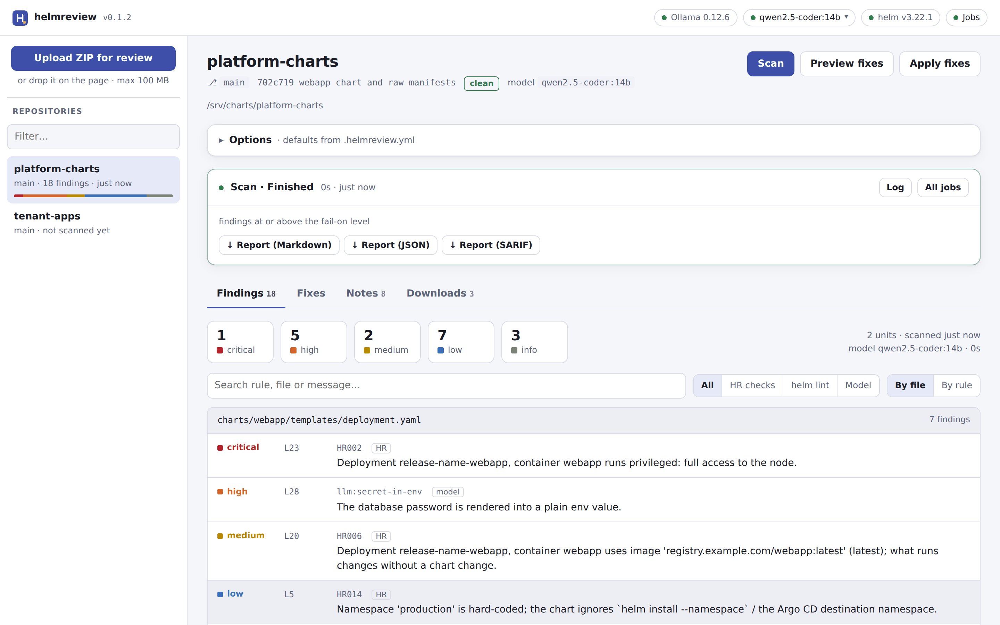
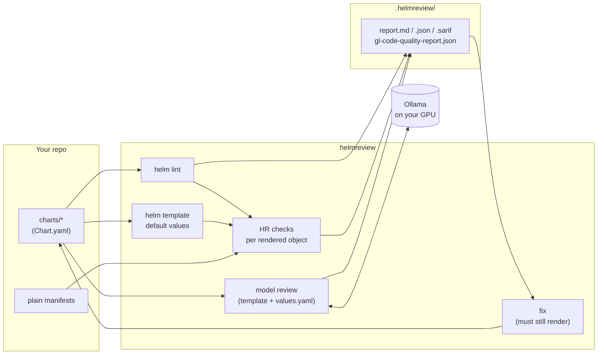

# helmreview

**Review Helm charts and Kubernetes manifests on your own hardware.** `helm
lint`, built-in checks on what each chart actually renders, and a local Ollama
model look at every chart and manifest folder, and the findings come out as
Markdown, JSON, SARIF and GitLab Code Quality.

No code leaves your network, and `helm` never talks to a cluster.

-   :material-rocket-launch: **[Quick start](getting-started/quickstart.md)**

    Install, pull a model, run `helmreview` in your chart repo.

-   :material-auto-fix: **[Automatic fixes](usage/fix.md)**

    The model fixes its findings, and only edits after which the chart still
    renders are kept. Nothing is committed.

-   :material-monitor-dashboard: **[Web UI](usage/web-ui.md)**

    Scan, browse findings, preview and apply fixes, upload a ZIP, from the browser.

-   :material-gitlab: **[GitLab merge requests](usage/merge-requests.md)**

    Review every new commit on open merge requests, with one comment per MR. No CI change needed.

[{ loading=lazy }](assets/screenshots/findings.png)

## Three layers

| Layer | What it finds |
|---|---|
| **`helm lint`** | Chart structure, template errors and deprecated APIs |
| **Built-in checks (HR0xx)** | Every chart is rendered with `helm template` and its default values, and each object is checked and mapped back to the template it came from: privileged or root containers, missing securityContext hardening (the *restricted* Pod Security Standard / OpenShift `restricted-v2`), host namespaces and hostPath, `latest` image tags, missing resources and probes, cluster-admin and wildcard RBAC, removed API versions, Ingress/Route without TLS, hard-coded namespaces and secrets, unpinned dependencies. See [Built-in rules](reference/rules.md) |
| **A local Ollama model** | Reviews each template with the chart's `values.yaml` next to it: wrong scope (`.` vs `$`), values that don't exist, selectors that don't match the pods, names that can exceed 63 characters, missing checksum annotations, upgrade traps. It is told what the first two layers found, so it looks for new problems |

Plain manifests (Kustomize bases, Argo CD apps, raw YAML) get the same object
checks.

## How it fits together

## Ways to run it

| How | Where it's described |
|---|---|
| CLI on your laptop or a GPU box | [Scan](usage/scan.md), [Automatic fixes](usage/fix.md) |
| Web UI for a folder of repos | [Web UI](usage/web-ui.md) |
| Container with helm built in (`ghcr.io/jwklijnsma/helmreview`) | [Docker](deploy/docker.md) |
| Service that starts at boot, in one command | [systemd service](deploy/systemd.md) |
| Merge-request reviewer that polls GitLab | [GitLab merge requests](usage/merge-requests.md) |
| CI job | [CI](deploy/ci.md) |

!!! tip "Sibling projects"
    [ansreview](https://jwklijnsma.github.io/ansreview/) does the same for
    Ansible, and [docpipe](https://jwklijnsma.github.io/docpipe/) writes
    documentation from Helm charts and manifests with the same Ollama server.
