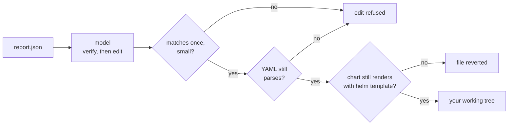

# Automatic fixes

```bash
helmreview fix                   # fix what the last scan found (runs a scan first if needed)
helmreview fix --dry-run         # only write .helmreview/fix.patch
helmreview fix --only charts/web # one chart
```

`fix` reads `.helmreview/report.json` (or `--from-report FILE`). When there is
no report yet, it runs a scan first.

## How it works

The model gets each file with its findings, **verifies them** (many model
findings are false positives) and either declines them or returns small, exact
search/replace edits. Every edit is checked before anything is written.



- The edit must match the file exactly once and stay small; a model that
  rewrites the file is refused.
- `values.yaml`, `Chart.yaml` and manifests must still parse as YAML.
- **The chart must still render** with `helm template`. If it rendered before
  and an edit breaks it, the file helm names is reverted, and, if that is not
  enough, the chart's other edits too.

Only model findings at or above `fix_min_severity` (`medium`) and
`fix_min_confidence` (`0.8`) are sent. Change that with `--min-severity` /
`--min-confidence`.

## HR findings need a human

The HR findings are listed in the fix report as **needs a human**, with what to
do: they touch values and defaults that are yours to decide (resources, probes,
security context, image tags, …). `--no-static-fix` leaves them out of the report.

## What you get

Work happens in a scratch copy. Nothing is committed.

| File | Contents |
|---|---|
| `git diff` | What changed. Undo with `git checkout -- .` |
| `.helmreview/fix-report.md` | What was fixed, declined, failed or needs a human |
| `.helmreview/fix.patch` | The diff, also with `--dry-run` |
| `.helmreview/backup/` | Outside git only: the original files |

`fix` refuses to run on a repo with uncommitted changes, so `git diff` shows
only its changes. Override with `--allow-dirty`.

## Speed

- **One request per file** with all of its findings. Set `fix_batch_size`
  (`--batch-size`) to cap the number of findings per request.
- **Excerpts for long files.** Files longer than `fix_full_file_lines` (120) are
  sent as excerpts of `fix_context_lines` (25) around each finding.
- **Streaming.** `timeout` is the longest the model may stay silent, not the total time.
- **Split on timeout.** A batch that times out is split in half and tried again.
- **Cache.** Answers and timeouts are cached in `.helmreview/fix-cache.json`, so
  a re-run only asks about files that changed. `--no-cache` asks again.
- **A smaller model** is often good enough: `helmreview fix --model qwen2.5-coder:7b`
  is about twice as fast, and every edit is verified anyway.
